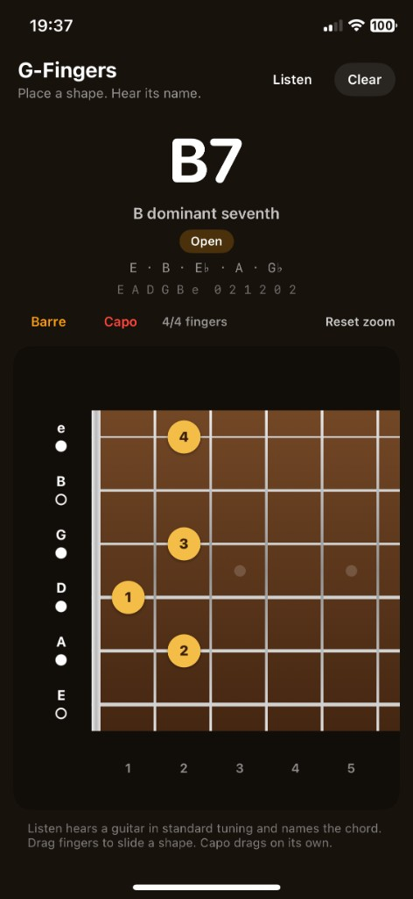

# G-Fingers

G-Fingers is an iPhone app for learning guitar chords by placing fingers on a fretboard — and by playing a real guitar into the microphone.

The Home Screen name is **G-Fingers**. The Xcode project is `GFingers`.

It runs on **iOS 16.7 and later** (including iPhone X). Standard tuning only: E A D G B e.

<p align="center">
  
</p>

## What you can do

- Plant up to **four fingers** on a 24-fret neck and see the chord name as you go.
- **Mute** individual strings, add a **barre**, and clip on a **capo**.
- **Drag a whole shape** up or down the neck; the capo stays put.
- **Listen** to a guitar and have G-Fingers name the chord and drop the matching textbook shape onto the board.
- Pinch to zoom, drag to pan. The nut is on the **left**, fret 1 then 2 toward the body, **high e on top** (player’s view).

With no fingers down and Listen off, the HUD shows **…** until you tap a fret or turn Listen on. Open strings alone are not named as a chord.

## Open in Xcode

```bash
open GFingers.xcodeproj
```

1. Select an iPhone simulator, or a connected iPhone with your Apple ID team.
2. Press Run.

On a personal (free) team, a sideloaded build lasts about **7 days**. The phone must Trust the developer under Settings → General → VPN & Device Management. Some school or work devices block that with MDM.

The first time you tap **Listen**, iOS asks for the microphone.

## The fretboard

| Control | What it does |
| --- | --- |
| Tap a fret | Plants or moves a finger on that string. Tap the same spot again to lift it. |
| String letter (E A D G B e) | Mutes or unmutes. ✕ muted, ○ open, ● fretted. |
| **Barre** | Next tap lays one finger from that string toward high e. Barre then turns off so extra taps add single fingers (F-shape, and so on). |
| **Capo** | Next tap places or removes the capo. Drag the red CAPO band to another fret; the neck does not pan while you drag. Frets behind the capo cannot be played. |
| Drag a yellow dot | Slides every finger (and any ringing opens that can move) by the same number of frets. Never invents a barre. |
| Pinch | Zooms the neck. **Reset zoom** returns to the default. |
| **Clear** | Empties fingers, mutes, and capo. Safe to tap on an already empty board. |
| **Listen** | Clears the board and names chords from the microphone. Tap again to stop. |

Finger count is shown as `n/4 fingers`.

## Chord names (tap mode)

G-Fingers names what is *sounding*: open strings plus fretted notes, skipping mutes. A capo is the new nut.

1. **Textbook shapes first** — open D, Dm, D7, D/F♯, G, C, E, Em, E7, A, Am, A7, F and Fm barres, Bm, B7, and power chords (A5, E5, D5, G5). Unused bass strings in a diagram may still ring open.
2. **Open D** is the 2–3–2 triangle (G, B, high e), including the same triangle shifted toward the bass or pointed at the nut. Low E at fret 2 with that triangle is **D/F♯**.
3. If the shape has moved up the neck, the name transposes (D slid to fret 4 is E).
4. Otherwise notes are matched to a quality (major, minor, 7, add9, …). A slash bass is added when the lowest note is not the root.

The HUD also shows a compact tab in low-E-first order, for example `E A D G B e  x x 0 2 3 2`.

## Listen mode

Listen is for a guitar in **standard tuning**, played close enough for the iPhone mic.

- A chromagram plus a bass band (about 75–200 Hz) pick a chord.
- Harmonics are discounted so open D/G stay **D** and **G** rather than D7/G7 or maj7, E does not become B, and Em/Am are not read as C7/F7.
- After a couple of stable frames the name updates and a matching **textbook voicing** is placed as yellow dots (when that symbol is in the catalog).
- While Listen is on you cannot tap or drag the neck.

Turn Listen off to edit the shape by hand again.

## Requirements

- Xcode (this project is built with a current Xcode against iOS 16.7+).
- An iPhone simulator, or a physical iPhone.
- Microphone permission for Listen.

Bundle ID: `com.gfingers.app`.

## Checks

From the repo root, a small Swift driver plants known shapes and checks the names:

```bash
swiftc -parse-as-library -o /tmp/VerifyChords \
  Tools/VerifyChords.swift \
  GFingers/Music/Tuning.swift \
  GFingers/Music/FretboardState.swift \
  GFingers/Music/GuitarShapes.swift \
  GFingers/Music/ChordDetector.swift \
  && /tmp/VerifyChords
```

That covers open D (including ringing bass), G, C, E, A, F barre, Bm, D/F♯, capo transposes, and sliding a shape.

## License

Use and change this project as you like. No warranty.
